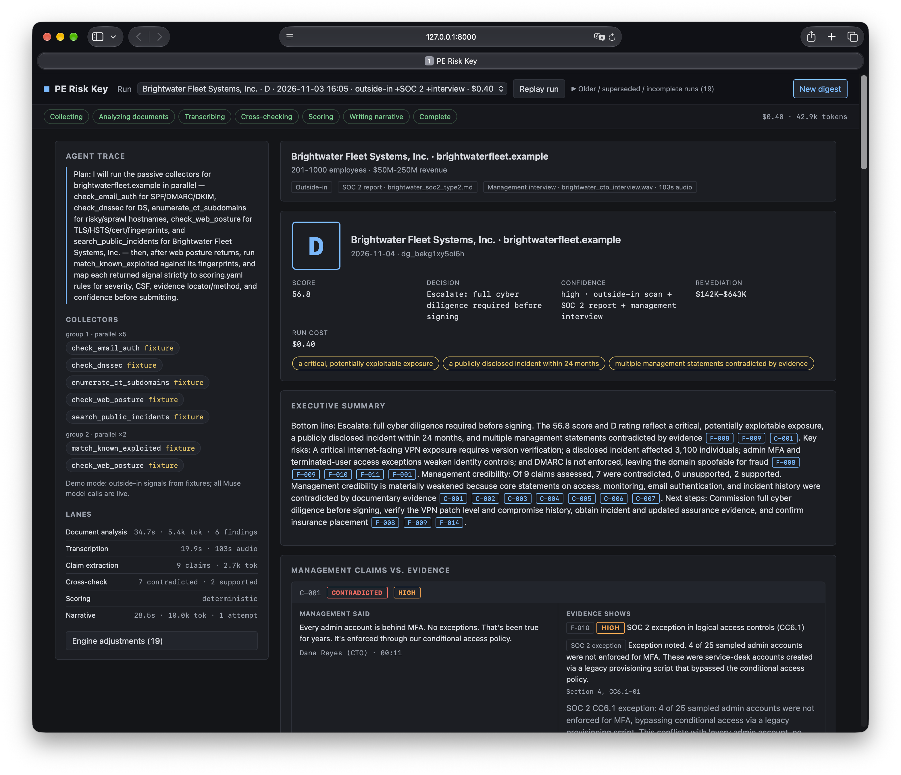
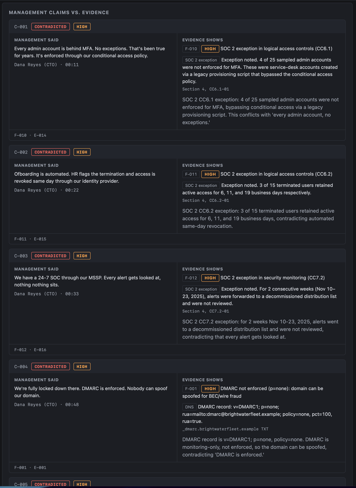
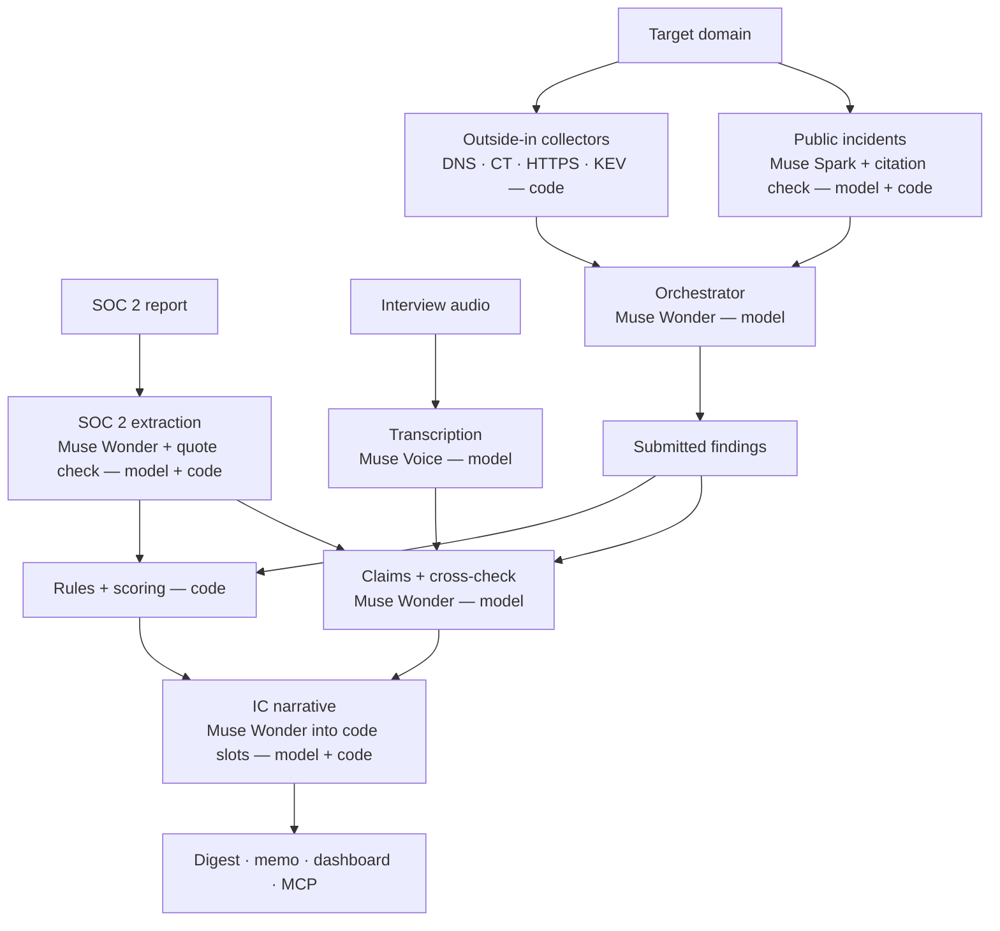

# PE Risk Key

Evidence-cited cyber risk digests for private equity, in minutes, built on Meta Muse.

## The problem

Cyber diligence for a deal usually means a management questionnaire, a SOC 2
PDF nobody re-verifies, and outside-in findings nobody can trace to evidence.
The deal team signs on a summary while the underlying claims go unchecked.
PE Risk Key produces a risk digest where every finding cites its evidence and
every management claim gets a verdict.

## What it does

- **Management claims vs. evidence:** cross-checks interview claims against
  collected evidence — contradicted / unsupported / supported — with excerpts
  and locators.
- **Passive outside-in collection:** email auth, DNSSEC, certificate
  transparency, web posture, CISA KEV, and public incidents. No scanning,
  no logins.
- **SOC 2 analysis:** extracts exceptions, tested controls, carve-outs,
  CUECs, and the bridge gap; every quote is verified against the report.
- **Deterministic scoring:** NIST CSF function scores, rating caps, deal
  signal, 100-day plan, and costs. Same inputs, byte-identical output.
- **Delivery:** an IC memo (markdown export), a live dashboard, and
  read-only MCP tools for an associate's AI assistant.

## Screenshots

<!-- Screenshots are captured from the dashboard and added before submission. -->



## Meta models

| Component | Model | Why |
|---|---|---|
| Orchestrator agent | `muse-wonder-1.0` | tool planning with parallel collector calls |
| SOC 2 extraction | `muse-wonder-1.0` | long-document structured extraction |
| Interview transcription | `muse-voice-transcribe-1.0` | speech-to-text with diarization |
| Public records | `muse-spark-1.3` | search grounding with citations |
| Claim cross-check | `muse-wonder-1.0` | claim extraction plus verdicts over the evidence catalog |
| IC narrative | `muse-wonder-1.0` | memo prose written into code-owned slots |
| Development | Muse Code | agentic coding CLI used to build the repo |

## Architecture

Model steps are labeled `model`; everything else is deterministic code.



## Why trust it

- **Verbatim-quote verification:** every extracted SOC 2 and claim quote must
  appear in its source after normalization; failures are dropped with a trace.
- **Numeric grounding:** deviation counts appear only if stated in the
  report; narrative numbers must come from scored input.
- **SOC 2 classification check:** "exceptions" whose result text says no
  exceptions noted are reclassified, not reported.
- **Code-owned citations and recommendation slots:** the model writes plain
  prose; code attaches `[F-xxx]`/`[C-xxx]` chips and fills recommendation
  slots from the trigger table.
- **Deterministic scoring and caps:** pure functions over findings; the eval
  re-scores twice and checks byte-identical JSON.
- **Coverage cap:** outside-in data alone caps the rating at B and conditions
  the deal signal — no A without documents and an interview.
- **Self-contained digests:** every cited id resolves to findings' evidence
  or `supporting_evidence`; one validator is used everywhere.
- **Safety boundary:** `net.py` is the only network chokepoint (a static
  test fails otherwise); uploads are checked by size, extension, and
  content; the API binds localhost only unless explicitly allowed.

## Results

<!-- EVAL:START -->
Models: muse-wonder-1.0 · Runs: 5 (brightwaterfleet.example x3, copperline.example x2) · Total cost: $1.3541

## brightwaterfleet.example (outside-in + SOC 2 + interview)

| run | finding recall | precision | contra recall | verdict acc | schema | narrative (att) | rating | profile | score | cost | time |
| --- | --- | --- | --- | --- | --- | --- | --- | --- | --- | --- | --- |
| `dg_1lsuvteab6tk` | 100.0% | 100.0% | 100.0% | 100.0% | pass | pass (1) | D (match) | match | 56.8 | $0.3850 | 48.9s |
| `dg_co0cxi7wkexh` | 100.0% | 100.0% | 100.0% | 100.0% | pass | pass (1) | D (match) | match | 56.8 | $0.3794 | 60.0s |
| `dg_6f0pdq5c5kbz` | 100.0% | 100.0% | 100.0% | 100.0% | pass | pass (1) | D (match) | match | 56.8 | $0.3872 | 65.7s |
| mean | 100.0% | 100.0% | 100.0% | 100.0% | | | | | 56.8 | | |
| min | 100.0% | 100.0% | 100.0% | 100.0% | | | | | | | |

## copperline.example (outside-in only)

| run | finding recall | precision | contra recall | verdict acc | schema | narrative (att) | rating | profile | score | cost | time |
| --- | --- | --- | --- | --- | --- | --- | --- | --- | --- | --- | --- |
| `dg_qitmmzuiskgb` | 100.0% | 100.0% | n/a | n/a | pass | pass (1) | B (match) | match | 98.4 | $0.1006 | 27.7s |
| `dg_xdi3nu467iqe` | 100.0% | 100.0% | n/a | n/a | pass | pass (1) | B (match) | match | 98.4 | $0.1020 | 31.1s |
| mean | 100.0% | 100.0% | n/a | n/a | | | | | 98.4 | | |
| min | 100.0% | 100.0% | n/a | n/a | | | | | | | |

## Aggregate

- schema pass rate: 100.0%
- narrative pass rate: 100.0%
- rating match fraction: 100.0%
- profile match fraction: 100.0%
- scoring determinism: 100.0% byte-identical
- brightwaterfleet.example score: 56.8, std dev 0.0, range 56.8–56.8
- copperline.example score: 98.4, std dev 0.0, range 98.4–98.4
<!-- EVAL:END -->

Regenerated with `make readme` from `eval/LATEST.md`.

## Cost and speed

<!-- COST:START -->
Mean $0.27 per run and 47s wall time across 5 runs (2026-11-03 eval).
<!-- COST:END -->

## Quickstart

```sh
make setup            # uv sync
cp .env.example .env  # set MODEL_API_KEY (https://dev.meta.ai)
make demo             # full Brightwater run: fixture collectors, live models
make serve            # dashboard at http://127.0.0.1:8000
make fresh-demo       # clear model caches, then serve
```

`.env` keys (all documented in `.env.example`): `MODEL_API_KEY`
(required), `MODEL_TIMEOUT_SECONDS` (default 300),
`PUBLIC_RECORDS_MAX_INPUT_TOKENS` (default 250000),
`PE_RISK_KEY_MODE` (`standard`; `confidential` is a stub),
`BASETEN_API_KEY` (reserved for confidential mode), `DEMO_MODE`,
`PE_RISK_KEY_RUNS_DIR`, `PE_RISK_KEY_ALLOW_REMOTE`.

## MCP

Read-only MCP server over stdio (`src/pe_risk_key/mcp_server.py`): reads
saved digests, never triggers runs or network calls. Tools: `list_digests`,
`get_risk_digest`, `explain_finding`, `compare_targets` (deterministic,
no model calls).

Claude Desktop config:

```json
{
  "mcpServers": {
    "pe-risk-key": {
      "command": "uv",
      "args": [
        "--directory", "/path/to/pe-risk-key",
        "run", "python", "-m", "pe_risk_key.mcp_server"
      ]
    }
  }
}
```

Then ask: "Compare Brightwater and Copperline for cyber risk before IC."

## Safety and scope

- Passive only: DNS queries, certificate-transparency logs, one HTTPS GET
  per host, two handshake-only TLS probes, search-grounded public records,
  and user-uploaded documents. No scanning, vulnerability probing, or
  authentication attempts. See `SPEC.md` §2.
- Demo targets are fictional companies on reserved `.example` domains.
- Live (non-demo) runs show a confirmation note before passive collection
  contacts the target's DNS and apex/www hosts.

## Limitations

- KEV matches are product-level (no version-range check).
- Public-incident search results vary run to run, and the parent/brand
  entity must be supplied via aliases.
- TLS 1.2 support isn't probed.
- CT log presence doesn't confirm live hosts.
- Cost bands are triage estimates.
- DMARC/SPF/DNSSEC reflect the moment of collection.
- Demo fixtures are synthetic: fictional companies, SOC 2 report, and
  interview recording.

## Roadmap

- Confidential mode: open-weight Muse Spark Open inference on a private
  endpoint for sensitive targets (stubbed in `providers.py`, SPEC §3).
- KEV version-range checks via NVD data.
- More document types: pen test reports, security questionnaires.
- Portfolio monitoring across targets over time.

## Provenance

Built Oct 27 – Nov 4, 2026 for the Meta Global AI Developer Hackathon
(Indie track). No code predates the event:
[commit history](https://github.com/wh1t3rbb1tz/pe-risk-key/commits/main)
and checkpoint tags
[checkpoint-oct28](https://github.com/wh1t3rbb1tz/pe-risk-key/tree/checkpoint-oct28),
[checkpoint-nov02](https://github.com/wh1t3rbb1tz/pe-risk-key/tree/checkpoint-nov02),
[checkpoint-nov02-night](https://github.com/wh1t3rbb1tz/pe-risk-key/tree/checkpoint-nov02-night).
Planning specs were drafted with AI assistance; all application code was
written during the event with Muse Code.

## License

PE Risk Key is licensed under the GNU Affero General Public License
v3.0 or later (AGPL-3.0-or-later). If you run a modified version as a
network service, you must make your source available to its users under
the same license. Commercial licensing inquiries: open an issue.
